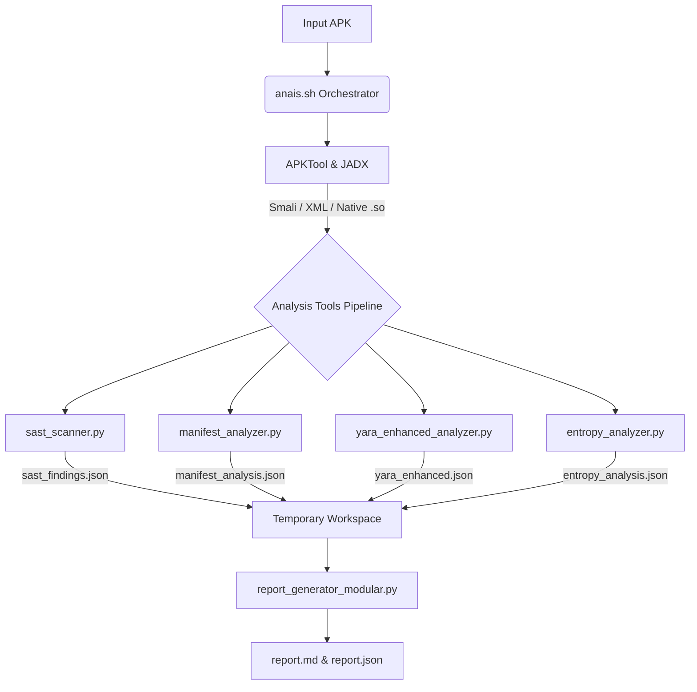

# Anais Tools Architecture & Flow

This document provides a comprehensive overview of the internal structure, tool components, and execution flow of the **Anais Static Analysis Framework**. 

It is designed for developers, contributors, and security researchers looking to understand how the internal Python scripts interact with the main bash orchestrator, and how to extend the framework.

---

## 1. High-Level Flow Overview

The framework operates via a straightforward pipeline:
1. **Decompilation & Unpacking**: Extracting the static components of the APK (Smali, Java, Native Libs, Resources).
2. **Parallel Tool Execution**: Running discrete, specialized Python scripts against the extracted data.
3. **Intermediate JSON Generation**: Each tool generates its own structured `.json` findings report in a temporary workspace.
4. **Modular Report Aggregation**: A generator script collects all JSON fragments and builds the final highly-formatted Markdown/JSON intelligence reports.

---

## 2. Core Orchestrator: `anais.sh`

The primary entry point to the framework is `anais.sh`. 

**Responsibilities**:
- Parsing user arguments (e.g., `-y/--yara` flags for custom rules).
- Setting up the isolated `analysis_workspace/` environment.
- Utilizing `apktool` to extract the `AndroidManifest.xml`, resources, and Smali bytecode.
- Utilizing `jadx` to decompile classes into readable Java source.
- Sequentially invoking the individual Python tooling found in the `analysis_tools/` directory.
- Supplying the outputs to the Modular Report Generator.

---

## 3. The `analysis_tools/` Pipeline

Each Python script in this directory operates independently, meaning a failure in one script will not crash the entire pipeline. They all read from the decompiled directories, perform specialized security logic, and output a JSON file containing their findings.

### 3.1 `sast_scanner.py`
**Purpose**: Performs massive Pattern Matching and Regex analysis on the codebase and resources.
- **Targets**: `.java`, `.smali`, `AndroidManifest.xml`, `strings.xml`, `assets/`, and Native `.so` binaries.
- **Key Detections**:
  - Automatically identifies API Keys (Google APIs, AWS, Stripe, Slack, Twilio, etc.).
  - Cryptographic weaknesses (MD5 hash usage, DES/ECB).
  - Malignant Webview configs (`setJavaScriptEnabled(true)`).
  - Hardcoded local secrets and passwords.
- **Output**: Generates `sast_findings.json` classifying matched findings with `critical`, `high`, `medium`, or `low` severity, alongside risk scores.

### 3.2 `manifest_analyzer.py`
**Purpose**: Parses and evaluates the configuration limits and metadata of the application.
- **Targets**: `AndroidManifest.xml`
- **Key Detections**:
  - Extracts the App ID, Versioning, and SDK configurations.
  - Pinpoints misconfigurations (e.g., `android:debuggable="true"`, `android:allowBackup="true"`, and Cleartext Traffic configs).
  - Highlights Dangerous Permissions globally requested by the app (e.g., `SYSTEM_ALERT_WINDOW`, `REQUEST_INSTALL_PACKAGES`).
  - Lists highly privileged components and unprotected exported activities/services.
- **Output**: Generates `manifest_analysis.json`.

### 3.3 `yara_enhanced_analyzer.py`
**Purpose**: Runs YARA rules recursively across the APK and decompiled source for massive threat intelligence correlation.
- **Capabilities**:
  - Dynamically processes multiple YARA configuration files passed via the `-y` flag in the CLI. 
  - Defaults to the built-in `rules/yara_general_rules.yar`.
  - Targets the raw APK directly, the decoded Smali, and the Jadx Java source.
- **Key Detections**: Matches against predefined intelligence indicating trojans, ransomware, obfuscators (DexProtector, Bangcle), or specific hacking toolkits.
- **Output**: Aggregates metadata limits and rule match conditions into `yara_enhanced.json`.

### 3.4 `entropy_analyzer.py`
**Purpose**: Specifically hunts for hidden, encrypted, or packed structures. 
- **Targets**: Dex files, Assets, and Native Libraries.
- **Key Detections**: Identifies segments possessing mathematically high entropy levels indicative of compressed payloads, encrypted strings, or packed stagers awaiting runtime decryption.
- **Output**: Generates `entropy_analysis.json` often containing recommendations for Dynamic Analysis (e.g., using Frida) to dump the decrypted payload from memory.

---

## 4. Reporting: `report_generator_modular.py`

Once all tools complete execution, the orchestrator invokes the modular reporter to tie everything together.

**How it works**:
- It consumes all intermediate `.json` fragments residing inside the temporary namespace.
- It translates raw data into a human-readable, beautifully formatted Markdown file (`report.md`).
- It applies severe threat algorithms to map all findings into a unified `App Risk Score` (0 - 100).
- Finally, it consolidates the disparate JSON fragments into a single combined `report.json` document to allow pipeline automation and third-party dashboard integrations.

---

## 5. How to Extend Anais (Adding a New Tool)

Adding a completely new analysis capability is frictionless due to the modular architecture:

1. **Create the Python Script**: Create a file in `analysis_tools/` (e.g., `analysis_tools/custom_heuristic.py`).
2. **Accept Directories**: Ensure your script accepts the paths from the command line (e.g., `<apk_path>`, `<decompiled_dir>`, `<temp_dir>`).
3. **Generate Standardized Output**: Have your script output its findings to a JSON file inside the temporary directory (e.g., `temp_dir/custom_findings.json`).
4. **Link to Orchestrator**: Add a bash call to your script inside the `anais.sh` main sequence loop.
5. **Update Reporter (Optional)**: If you desire the new data manually structured in the Markdown output, update `report_generator_modular.py` to parse your specific `custom_findings.json` outputs and format the markdown sections. (Otherwise, standard JSON will just be bundled automatically).
