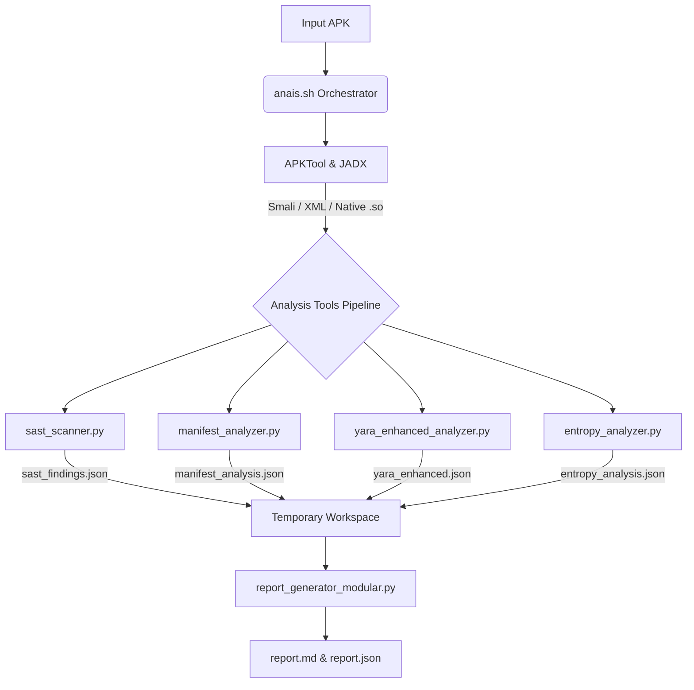

# Anais Tools Architecture & Flow

This document provides a comprehensive overview of the internal structure, tool components, and execution flow of the **Anais Static Analysis Framework**. 

It is designed for developers, contributors, and security researchers looking to understand how the internal Python scripts interact with the main bash orchestrator, and how to extend the framework.

---

## 1. High-Level Flow Overview

The framework operates via a straightforward pipeline:
1. **Decompilation & Unpacking**: Extracting the static components of the APK (Smali, Java, Native Libs, Resources).
2. **Parallel Tool Execution**: Running discrete, specialized Python scripts against the extracted data.
3. **Intermediate JSON Generation**: Each tool generates its own structured `.json` findings report in a temporary workspace.
4. **Modular Report Aggregation**: A generator script collects all JSON fragments and builds the final highly-formatted Markdown/JSON intelligence reports.

---

## 2. Core Orchestrator: `anais.sh`

The primary entry point to the framework is `anais.sh`. 

**Responsibilities**:
- Parsing user arguments (e.g., `-y/--yara` flags for custom rules).
- Resolving the workspace location (`ANAIS_WORKSPACE` env → `paths.workspace` in config → `~/.anais/reports`).
- Normalizing the input container to a base APK via `prepare_input.py` (`.apk`/`.xapk`/`.apkm`/`.apks`/`.aab`).
- Running `apktool` and `jadx` **concurrently** to extract Smali/resources and Java source.
- Invoking the `analysis_tools/` scripts **in parallel**, each writing its own JSON, with per-tool output buffered and printed in a fixed order.
- Supplying the JSON fragments to the Modular Report Generator, then generating derived outputs (`frida_auto.js`, `report.sarif`).

**Parallelism note**: decompilation and the analysis tools run as backgrounded jobs joined with `wait`. Because each tool writes a distinct JSON file and reads only shared read-only trees, there are no inter-tool data races. A tool exiting non-zero logs a warning and never aborts the run.

---

## 3. The `analysis_tools/` Pipeline

Each Python script in this directory operates independently, meaning a failure in one script will not crash the entire pipeline. They all read from the decompiled directories, perform specialized security logic, and output a JSON file containing their findings.

### 3.1 `sast_scanner.py`
**Purpose**: Performs massive Pattern Matching and Regex analysis on the codebase and resources.
- **Targets**: `.java`, `.smali`, `AndroidManifest.xml`, `strings.xml`, `assets/`, and Native `.so` binaries.
- **Key Detections**:
  - Automatically identifies API Keys (Google APIs, AWS, Stripe, Slack, Twilio, etc.).
  - Cryptographic weaknesses (MD5 hash usage, DES/ECB).
  - Malignant Webview configs (`setJavaScriptEnabled(true)`).
  - Hardcoded local secrets and passwords.
- **Output**: Generates `sast_findings.json` classifying matched findings with `critical`, `high`, `medium`, or `low` severity, alongside risk scores.

### 3.2 `manifest_analyzer.py`
**Purpose**: Parses and evaluates the configuration limits and metadata of the application.
- **Targets**: `AndroidManifest.xml`
- **Key Detections**:
  - Extracts the App ID, Versioning, and SDK configurations.
  - Pinpoints misconfigurations (e.g., `android:debuggable="true"`, `android:allowBackup="true"`, and Cleartext Traffic configs).
  - Highlights Dangerous Permissions globally requested by the app (e.g., `SYSTEM_ALERT_WINDOW`, `REQUEST_INSTALL_PACKAGES`).
  - Lists highly privileged components and unprotected exported activities/services.
- **Output**: Generates `manifest_analysis.json`.

### 3.3 `yara_enhanced_analyzer.py`
**Purpose**: Runs YARA rules recursively across the APK and decompiled source for massive threat intelligence correlation.
- **Capabilities**:
  - Dynamically processes multiple YARA configuration files passed via the `-y` flag in the CLI. 
  - Defaults to the built-in `rules/yara_general_rules.yar`.
  - Targets the raw APK directly, the decoded Smali, and the Jadx Java source.
- **Key Detections**: Matches against predefined intelligence indicating trojans, ransomware, obfuscators (DexProtector, Bangcle), or specific hacking toolkits.
- **Output**: Aggregates metadata limits and rule match conditions into `yara_enhanced.json`.

### 3.4 `entropy_analyzer.py`
**Purpose**: Specifically hunts for hidden, encrypted, or packed structures. 
- **Targets**: Dex files, Assets, and Native Libraries.
- **Key Detections**: Identifies segments possessing mathematically high entropy levels indicative of compressed payloads, encrypted strings, or packed stagers awaiting runtime decryption.
- **Output**: Generates `entropy_analysis.json` often containing recommendations for Dynamic Analysis (e.g., using Frida) to dump the decrypted payload from memory.

### 3.5 `detect_rasp.py`
**Purpose**: Identifies RASP (Runtime Application Self-Protection) and packer/shell solutions so the analyst knows which runtime defenses to expect before dynamic analysis.
- **Targets**: Native libraries (decoded `lib/` and raw APK entries), Smali/JADX package paths, `assets/`, `AndroidManifest.xml`, and Smali strings.
- **Families**: Talsec/freeRASP, Appdome, Promon SHIELD, DexGuard, DexProtector, Zimperium zShield, LiAPP, AppSealing, Bangcle/SecNeo, Ijiami, Tencent Legu, Qihoo 360 Jiagu, Baidu Protect, Alibaba Mobisec, Seciron, Kiwano.
- **Scoring**: Strong artifacts (exact library, stub/wrapper `Application` class, vendor package) score 35-45 each; keyword hits are capped at 24 per family. Only families scoring 25 or more get a verdict; the rest are listed under `weak_signals`.
- **Heuristics**: Randomized hex native library names and random high-entropy asset names are reported vendor-neutrally under `heuristics`.
- **Fallback**: Reads library and asset names straight from the APK zip when APKTool fails.
- **Output**: Generates `rasp_report.json` (`type`, `confidence`, `detected`, `protection_details`, `evidence`, `weak_signals`, `heuristics`, `recommendations`).
- **Tests**: `python3 -m unittest discover -s tests`

### 3.6 `detect_framework.py`
**Purpose**: Classifies the cross-platform framework so the analyst knows where the real logic lives, since Java/Smali SAST cannot see it.
- **Detects**: Flutter (`libapp.so`), React Native (`index.android.bundle`, Hermes vs plain-JS), Xamarin/.NET (`assemblies/*.dll`), Unity (`libil2cpp.so`), Cordova/Ionic (`assets/www/`).
- **Reports**: the logic artifact, the recommended decompiler and whether it is installed, and a coverage caveat when logic sits outside the scanned Java.
- **Output**: `framework_report.json`.

### 3.7 `signing_analyzer.py`
**Purpose**: Inspects the signing block and certificate chain.
- **Detects**: signature scheme versions (v1/v2/v3/v4), v1-only signing (Janus / CVE-2017-13156), debug certificates, self-signed context, weak signature algorithms (MD5/SHA1), short RSA keys; emits the certificate SHA-256 for cross-app reuse correlation.
- **Output**: `signing_analysis.json`.

### 3.8 `sdk_inventory.py`
**Purpose**: Enumerates bundled third-party SDKs from package paths, classifies them (ads/analytics/tracker/payment/…), extracts a version when discoverable, and — only with `--online` (`ANAIS_CVE_ONLINE=1`) — queries OSV.dev for CVEs.
- **Output**: `sdk_inventory.json`.

### 3.9 `prepare_input.py` (pre-pipeline)
**Purpose**: Normalizes any supported container to a single base APK and inventories splits/feature modules. Builds a universal APK from an `.aab` when `bundletool` is available.
- **Output**: `prepare_input.json`; prints `BASE_APK=<path>` for the orchestrator.

---

## 4. Reporting: `report_generator_modular.py`

Once all tools complete execution, the orchestrator invokes the modular reporter to tie everything together.

**How it works**:
- It consumes all intermediate `.json` fragments residing inside the temporary namespace.
- It translates raw data into a human-readable, beautifully formatted Markdown file (`report.md`).
- **Composite risk score**: `compute_composite_risk()` combines every analyzer's signal into one 0–100 score — YARA matches (cap 30), SAST severity log-damped (cap 25), packing/encrypted payloads (cap 20), signing issues (cap 10), manifest misconfig (cap 10), suspicious network (cap 10), commercial packer present (cap 5). The raw SAST `risk_score` is still shown alongside. Unlike the raw score it does not saturate from sheer finding count, so it is comparable across apps. The result is surfaced in `report.json` under `risk`.
- Finally, it consolidates the disparate JSON fragments into a single combined `report.json` document.

### 4.1 Derived outputs

After the main report, `anais.sh` runs:
- `frida_script_generator.py` → `reports/frida_auto.js`: a Frida script assembled from the findings (SSL unpinning, crypto/key logging, root/debug bypass, native JNI trace, vendor-specific notes).
- `sarif_exporter.py` → `reports/report.sarif`: SARIF 2.1.0 export of SAST findings for CI/code scanning.

### 4.2 Version diffing

`diff_reports.py <old report.json> <new report.json>` compares two analyses and reports deltas in risk score, permissions, network endpoints, native libraries, SDKs, framework and RASP — useful for catching a malicious update.

### 4.3 REA bridge (optional deep analysis)

`rea_bridge.py` runs only when `ANAIS_REA=1`. It is a two-mode integration with [REA](https://github.com/morluto/rea):

- **Phase 1 (in-pipeline, cheap):** it invokes REA's fast, deterministic mobile commands — `inspect-apk-signature`, `identify-flutter-build`, `inspect-il2cpp-metadata` (Unity), `inspect-managed-members` (Xamarin/.NET), and `inspect-native-exports` per `.so` — parses each `normalized_result`, and records the `evidence_id` plus a short summary into `rea_report.json`. The report renders this as the **REA Deep Analysis** section. None of these need a native disassembler.
- **Phase 2 (agent-driven, deep):** it writes `reports/rea_targets.json`, a handoff listing the expensive questions (trace `JNI_OnLoad` and the kill path for a detected RASP vendor, decompile `libapp.so` with blutter, map the login flow, decompile Xamarin assemblies). An agent with REA's MCP tools connected answers these on demand; the slow Ghidra/graph/dynamic work is deliberately kept out of the automated run.

Command resolution: `$ANAIS_REA_CMD` → `rea` on PATH → `npx -y rea-agents@<ver>`. `ANAIS_REA_SKIP=1` disables it, `ANAIS_REA_MAX_SO` caps the native-export scan, `ANAIS_REA_TIMEOUT` bounds each call. REA preserves observation/inference/unknown distinctions and Evidence IDs; the bridge keeps those in the report rather than flattening them into findings.

---

## 5. How to Extend Anais (Adding a New Tool)

Adding a completely new analysis capability is frictionless due to the modular architecture:

1. **Create the Python Script**: Create a file in `analysis_tools/` (e.g., `analysis_tools/custom_heuristic.py`).
2. **Accept Directories**: Ensure your script accepts the paths from the command line (e.g., `<apk_path>`, `<decompiled_dir>`, `<temp_dir>`).
3. **Generate Standardized Output**: Have your script output its findings to a JSON file inside the temporary directory (e.g., `temp_dir/custom_findings.json`).
4. **Link to Orchestrator**: Add a `run_*` function and append its name to the `par_tasks` array in `anais.sh` so it runs in parallel with the other tools.
5. **Update Reporter (Optional)**: If you desire the new data manually structured in the Markdown output, update `report_generator_modular.py` to parse your specific `custom_findings.json` outputs and format the markdown sections. (Otherwise, standard JSON will just be bundled automatically).
